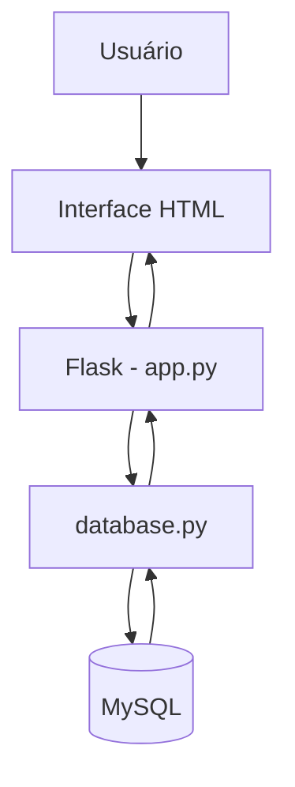
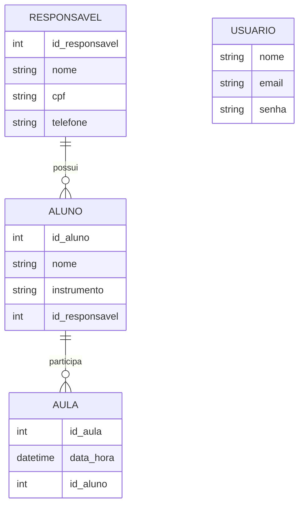

# 🎓 Sistema de Gestão Escolar

<div align="center">

### Gerenciamento de alunos, responsáveis e aulas

Uma aplicação web desenvolvida em Python para facilitar o gerenciamento de informações escolares, oferecendo cadastro de alunos, controle de responsáveis, organização de aulas e autenticação de usuários.

<br>


<br>

[📂 Repositório](https://github.com/mantuanpietro/PROVA-PR-TICA) • [🚀 Instalação](#-instalação-e-execução) • [📖 Documentação](#-documentação-do-sistema)

</div>

---

## 📌 Sobre o projeto

O **Sistema de Gestão Escolar** é uma aplicação web desenvolvida para auxiliar na organização e administração de informações relacionadas a uma instituição de ensino.

O sistema permite que usuários autenticados realizem o gerenciamento de responsáveis, alunos e aulas, centralizando informações importantes em uma interface intuitiva e facilitando o acesso e a atualização dos dados.

A aplicação foi desenvolvida utilizando **Python e Flask** no backend, **MySQL** para armazenamento de dados e templates HTML para construção das interfaces.

O projeto também implementa mecanismos de autenticação, gerenciamento de sessões e criptografia dos dados de CPF dos responsáveis armazenados no banco de dados.

---

## 🎯 Objetivos

- Desenvolver uma aplicação web para gerenciamento escolar.
- Implementar autenticação de usuários.
- Permitir o cadastro, consulta, edição e exclusão de responsáveis.
- Permitir o cadastro de alunos vinculados aos seus responsáveis.
- Gerenciar e consultar aulas cadastradas.
- Utilizar banco de dados relacional para persistência de informações.
- Aplicar conceitos de segurança no armazenamento de dados pessoais.
- Integrar backend, frontend e banco de dados.

---

## ✨ Funcionalidades

<table>
<tr>
<td width="50%">

### 🔐 Autenticação

- Login de usuários.
- Validação de email e senha.
- Controle de acesso às páginas.
- Gerenciamento de sessões.
- Logout.
- Expiração automática da sessão.

</td>
<td width="50%">

### 👨‍👩‍👧 Gestão de responsáveis

- Cadastro de responsáveis.
- Listagem de responsáveis.
- Pesquisa por nome.
- Visualização de informações.
- Edição de cadastro.
- Exclusão de registros.

</td>
</tr>
<tr>
<td width="50%">

### 🎓 Gestão de alunos

- Cadastro de alunos.
- Registro do nome.
- Registro do instrumento.
- Associação com responsável cadastrado.

</td>
<td width="50%">

### 📅 Gestão de aulas

- Listagem de aulas.
- Consulta de informações dos alunos.
- Visualização dos responsáveis.
- Consulta de datas e horários.
- Alteração da data e horário das aulas.

</td>
</tr>
</table>

---

## 🖥️ Tecnologias utilizadas

| Tecnologia | Descrição |
|---|---|
| Python | Linguagem utilizada no backend |
| Flask | Framework para desenvolvimento web |
| MySQL | Banco de dados relacional |
| MySQL Connector | Conexão entre Python e MySQL |
| HTML5 | Estrutura das páginas |
| CSS3 | Estilização das interfaces |
| Jinja2 | Renderização dinâmica dos templates |
| Werkzeug | Segurança e validação de senhas |
| Git | Controle de versão |
| GitHub | Hospedagem do código-fonte |

---

## 🏗️ Arquitetura do projeto

O projeto utiliza uma arquitetura simples dividida em três partes principais:



### 🔹 Frontend

Responsável pela interface visual e interação com o usuário.

Utiliza:

- HTML
- CSS
- Templates Jinja2

### 🔹 Backend

Responsável pelo processamento das requisições, validação de acesso, controle das sessões e comunicação com o banco de dados.

Utiliza:

- Python
- Flask

### 🔹 Banco de dados

Responsável pelo armazenamento persistente das informações.

Utiliza:

- MySQL
- SQL
- Relacionamentos entre tabelas

---

## 📂 Estrutura de arquivos

```text
PROVA-PR-TICA/
│
├── app.py
│   └── Aplicação principal Flask
│
├── database.py
│   └── Conexão e operações com o banco de dados
│
├── db/
│   └── Arquivos relacionados ao banco de dados
│
├── templates/
│   ├── login.html
│   ├── home.html
│   ├── responsaveis.html
│   ├── novo_responsavel.html
│   ├── editar_responsavel.html
│   ├── novo_aluno.html
│   ├── aulas.html
│   └── editar_aula.html
│
├── static/
│   └── Arquivos estáticos
│       ├── css/
│       ├── js/
│       └── imagens/
│
├── mer.excalidraw
│   └── Modelo visual do banco de dados
│
├── mer_atual.svg
│   └── Diagrama do banco de dados
│
└── README.md
    └── Documentação do projeto
```

---

# 📖 Documentação do sistema

## 🔐 1. Autenticação

O sistema possui uma tela de login que permite que usuários cadastrados acessem as funcionalidades administrativas.

### Funcionamento

1. O usuário informa seu email e senha.
2. O sistema envia as informações para o backend.
3. O backend consulta o usuário no banco de dados.
4. A senha informada é verificada utilizando a função `check_password_hash`.
5. Caso as credenciais sejam válidas, uma sessão é iniciada.
6. O usuário é redirecionado para a página principal.

Caso as informações estejam incorretas, uma mensagem de erro é exibida.

### Segurança

O sistema utiliza:

- Sessões Flask.
- Verificação de senha com hash.
- Proteção das páginas internas por autenticação.
- Encerramento de sessão por logout.
- Tempo limite de sessão.

---

## 👨‍👩‍👧 2. Gerenciamento de responsáveis

O módulo de responsáveis permite administrar os dados das pessoas responsáveis pelos alunos.

### Cadastro

O usuário pode cadastrar:

- Nome completo.
- CPF.
- Telefone.

O CPF é armazenado utilizando criptografia AES no banco de dados.

### Pesquisa

O sistema permite pesquisar responsáveis utilizando o nome como parâmetro.

A pesquisa utiliza uma consulta SQL com `LIKE`, permitindo localizar registros por correspondência parcial.

### Edição

Os dados de um responsável existente podem ser atualizados.

### Exclusão

O sistema permite excluir um responsável por meio de uma requisição POST.

---

## 🎓 3. Gerenciamento de alunos

O módulo de alunos permite cadastrar estudantes vinculados a um responsável.

### Informações cadastradas

- Nome do aluno.
- Instrumento.
- Responsável associado.

### Funcionamento

1. O usuário acessa o formulário de cadastro.
2. Informa os dados do aluno.
3. Seleciona um responsável previamente cadastrado.
4. O sistema envia os dados para o backend.
5. O backend realiza a inserção no banco de dados.
6. Uma mensagem de confirmação é exibida.

O relacionamento entre aluno e responsável permite organizar os registros de forma estruturada.

---

## 📅 4. Gerenciamento de aulas

O módulo de aulas permite consultar e atualizar os horários das aulas cadastradas.

### Listagem

O sistema apresenta informações como:

- Identificação da aula.
- Data e horário.
- Nome do aluno.
- Instrumento.
- Nome do responsável.
- Telefone do responsável.
- CPF do responsável.

Os dados são obtidos através de consultas SQL que relacionam as tabelas de aulas, alunos e responsáveis.

### Alteração de horário

O usuário pode selecionar uma aula e alterar sua data e horário.

O sistema recebe a informação através de um formulário, converte o valor para o formato `datetime` e atualiza o registro correspondente no banco de dados.

---

# 🗄️ Banco de dados

O sistema utiliza o MySQL como banco de dados relacional.

O banco utilizado pela aplicação possui o nome:

```sql
escola_db
```

## 📊 Estrutura conceitual

O banco de dados utiliza tabelas relacionadas para armazenar os dados da aplicação.

### Tabela `usuario`

Armazena os usuários responsáveis pelo acesso ao sistema.

| Campo | Descrição |
|---|---|
| `nome` | Nome do usuário |
| `email` | Email de autenticação |
| `senha` | Hash da senha |

### Tabela `responsavel`

Armazena os dados dos responsáveis pelos alunos.

| Campo | Descrição |
|---|---|
| `id_responsavel` | Identificador único |
| `nome` | Nome completo |
| `cpf` | CPF criptografado |
| `telefone` | Telefone de contato |

### Tabela `aluno`

Armazena os dados dos alunos.

| Campo | Descrição |
|---|---|
| `id_aluno` | Identificador único |
| `nome` | Nome do aluno |
| `instrumento` | Instrumento estudado |
| `id_responsavel` | Referência ao responsável |

### Tabela `aula`

Armazena as informações das aulas.

| Campo | Descrição |
|---|---|
| `id_aula` | Identificador único |
| `data_hora` | Data e horário da aula |
| `id_aluno` | Referência ao aluno |

### Relacionamentos



---

# 🔒 Segurança dos dados

O projeto implementa alguns mecanismos para proteger as informações armazenadas.

### Criptografia do CPF

O CPF dos responsáveis é armazenado utilizando a função:

```sql
AES_ENCRYPT()
```

Para recuperar os dados, é utilizada:

```sql
AES_DECRYPT()
```

A chave utilizada na implementação atual está definida no arquivo `database.py`.

### Senhas

As senhas dos usuários são verificadas utilizando:

```python
check_password_hash()
```

Isso permite verificar a senha informada sem comparar diretamente o texto puro com o valor armazenado no banco.

### Controle de acesso

As páginas internas verificam se existe uma sessão autenticada antes de permitir o acesso.

Caso o usuário não esteja autenticado, ele é redirecionado para a tela de login.

---

# 🚀 Instalação e execução

## 📋 Pré-requisitos

Antes de iniciar, instale:

- [Python](https://www.python.org/downloads/)
- [MySQL Community Server](https://dev.mysql.com/downloads/mysql/)
- [MySQL Workbench](https://dev.mysql.com/downloads/workbench/)
- [Git](https://git-scm.com/)
- [Visual Studio Code](https://code.visualstudio.com/)

---

## 1️⃣ Clonar o repositório

Abra o terminal e execute:

```bash
git clone https://github.com/mantuanpietro/PROVA-PR-TICA.git
```

---

## 2️⃣ Acessar a pasta do projeto

```bash
cd PROVA-PR-TICA
```

---

## 3️⃣ Criar ambiente virtual

Recomenda-se utilizar um ambiente virtual para isolar as dependências do projeto.

### Windows

```bash
python -m venv venv
```

Ative o ambiente:

```bash
venv\Scripts\activate
```

### Linux ou macOS

```bash
python3 -m venv venv
```

Ative:

```bash
source venv/bin/activate
```

---

## 4️⃣ Instalar as dependências

Instale as bibliotecas utilizadas pelo projeto:

```bash
pip install Flask mysql-connector-python
```

Caso necessário, instale também:

```bash
pip install Werkzeug
```

---

## 5️⃣ Configurar o MySQL

Abra o MySQL Workbench e conecte-se ao servidor local.

Crie o banco de dados:

```sql
CREATE DATABASE escola_db;
```

Selecione o banco:

```sql
USE escola_db;
```

Crie as tabelas necessárias de acordo com o modelo de dados do projeto.

> Os campos e relacionamentos devem ser compatíveis com as consultas utilizadas no arquivo `database.py`.

---

## 6️⃣ Configurar a conexão

O arquivo `database.py` contém a função responsável pela conexão com o banco de dados.

Exemplo de configuração utilizada:

```python
import mysql.connector

def conectar():
    return mysql.connector.connect(
        host="localhost",
        user="root",
        password="senai",
        database="escola_db"
    )
```

Caso seu MySQL utilize outra senha ou usuário, altere as informações de conexão para corresponder ao ambiente local.

---

## 7️⃣ Executar a aplicação

Com o ambiente virtual ativado e o banco de dados configurado, execute:

```bash
python app.py
```

O servidor Flask será iniciado.

Acesse no navegador:

```text
http://127.0.0.1:5000
```

---

# 🧪 Testando a aplicação

Após iniciar o servidor, verifique as funcionalidades:

| Funcionalidade | Teste |
|---|---|
| Login | Inserir credenciais válidas |
| Login inválido | Inserir credenciais incorretas |
| Página inicial | Acessar após autenticação |
| Responsáveis | Consultar os registros |
| Pesquisa | Pesquisar responsável pelo nome |
| Cadastro | Cadastrar novo responsável |
| Edição | Alterar dados de um responsável |
| Exclusão | Excluir um responsável |
| Alunos | Cadastrar novo aluno |
| Aulas | Consultar aulas cadastradas |
| Horários | Alterar data e horário de uma aula |
| Logout | Encerrar a sessão |

---

# 🧠 Conceitos aplicados

Durante o desenvolvimento do projeto, foram utilizados diversos conceitos relacionados ao desenvolvimento de sistemas.

### Backend

- Criação de rotas.
- Requisições HTTP.
- Métodos GET e POST.
- Redirecionamentos.
- Renderização de templates.
- Controle de sessões.
- Autenticação.
- Manipulação de formulários.

### Banco de dados

- SQL.
- SELECT.
- INSERT.
- UPDATE.
- DELETE.
- JOIN.
- Chaves primárias.
- Chaves estrangeiras.
- Relacionamentos.
- Criptografia de dados.

### Python

- Funções.
- Importação de módulos.
- Manipulação de datas.
- Tratamento de dados.
- Integração com banco de dados.
- Estruturas condicionais.

---

# 🛠️ Possíveis melhorias futuras

O projeto pode evoluir com a implementação de novas funcionalidades:

- [ ] Cadastro de novos usuários.
- [ ] Diferentes níveis de acesso.
- [ ] Dashboard com indicadores.
- [ ] Calendário visual de aulas.
- [ ] Filtros por instrumento.
- [ ] Relatórios de alunos e responsáveis.
- [ ] Exportação de dados para PDF.
- [ ] Validação de CPF.
- [ ] Validação de telefone.
- [ ] Melhor gerenciamento de erros.
- [ ] Configuração utilizando variáveis de ambiente.
- [ ] Melhorias na segurança das sessões.
- [ ] Interface responsiva para dispositivos móveis.
- [ ] Sistema de notificações.
- [ ] Histórico de alterações.

---

# 📌 Observações importantes

- O banco de dados MySQL deve estar ativo para que a aplicação funcione.
- As credenciais de conexão devem corresponder ao ambiente local.
- O banco `escola_db` precisa estar previamente configurado.
- Os usuários necessários para autenticação devem existir no banco de dados.
- As tabelas devem possuir os campos esperados pelo código.
- A chave utilizada na criptografia do CPF deve ser consistente para criptografar e descriptografar os dados.
- O projeto foi desenvolvido com finalidade educacional.

---

# 👨‍💻 Desenvolvedor

<div align="center">

### Pietro Mantuan

Estudante de Desenvolvimento de Sistemas

[](https://github.com/mantuanpietro)

</div>

---

<div align="center">

### Desenvolvido para fins educacionais 💻

**Python • Flask • MySQL**

</div>
